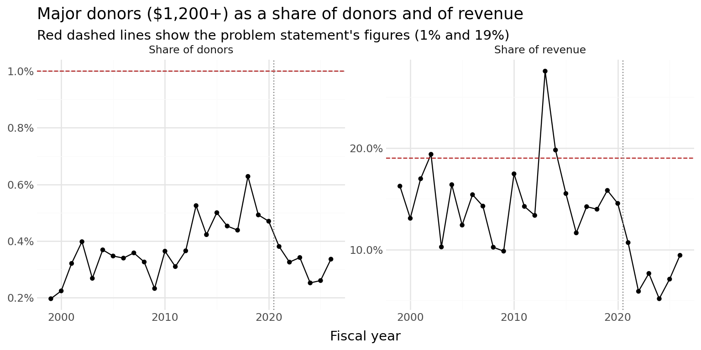
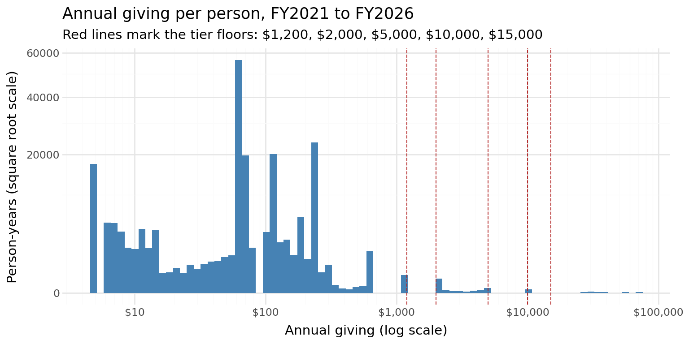
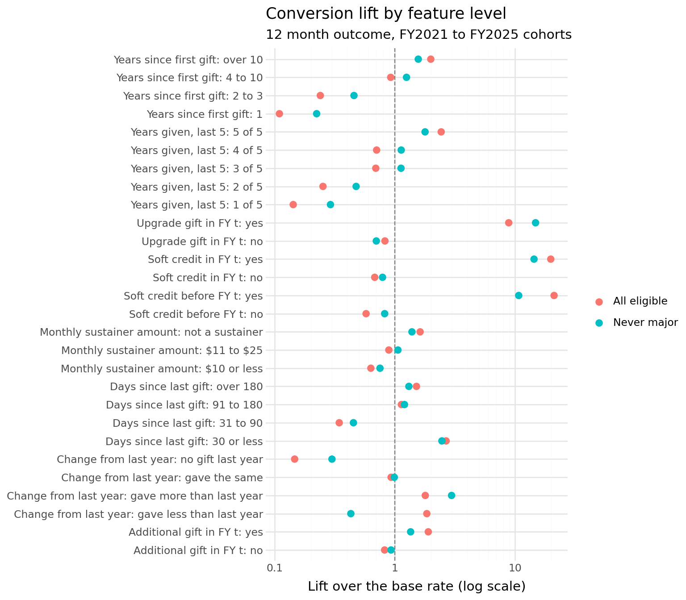

# PBS Utah Major Donor Prediction: Finding Tomorrow's Major Donors

**Author:** Benjamin Hogan
**Course:** IS 6813, MSBA Capstone, University of Utah (Fall 2026)
**Tools:** Python · Polars · plotnine · Quarto
**Status:** Work in progress. Exploratory data analysis complete, modeling underway.

> **Work in progress.** This repository documents my individual work on a team capstone project. The EDA is finished and reflects the current state of the analysis. Modeling, evaluation, and the final deliverables are still in progress, and this README will be updated as they are completed. Initial results are due November 11, 2026, and the final project is due December 2, 2026.

---

## Project Overview

Congress eliminated federal funding for public broadcasting in 2025, leaving PBS Utah with an estimated recurring shortfall of about $2 million per year. Major donors, people who give $1,200 or more in a fiscal year, generate a large share of donor revenue, but PBS Utah has no reliable, data-driven way to tell which current non-major donors are most likely to become major donors, or at what giving level.

The project builds a ranked prospect list so development staff can spend limited cultivation time on the donors with the strongest evidence of major-giving potential. The model will estimate each eligible donor's probability of reaching $1,200 or more within 12 months (immediate priority) and within 3 to 5 years (long-term nurture), along with the most likely giving tier.

- **Problem type:** Binary classification with an extremely rare outcome, plus a tier prediction
- **Unit of analysis:** Individual donor at the end of a fiscal year
- **Target:** Individual fiscal-year giving of $1,200 or more (own payments plus soft credits)
- **Eligible population:** Donors who gave in the fiscal year that just ended, but gave less than $1,200
- **Validation:** Time-based backtesting by cohort, with spouses kept in the same fold
- **Evaluation:** Recall, precision, and lift at a fixed list size, compared against simple baselines

This repository holds my individual contributions. The team will combine individual work into a group EDA and a shared model.

---

## The Data

The course provides a replicated version of PBS Utah's donor data, so no real donor records are used. It contains nine tables:

| Table | Contents | Coverage |
|---|---|---|
| Constituents | One row per person, with demographics and classification fields | Snapshot at end of FY2026 |
| Unite payments | Individual payments in the current donor system | FY2021 to FY2026 |
| Legacy payments | Gifts from the previous donor system | FY1984 to FY2020 |
| Soft credits | Gifts paid by donor-advised funds and other organizations, credited to a person | FY2021 to FY2026 |
| Campaign codes and members | Solicitations sent and whether each drew a response | FY2021 to FY2026 |
| Passport viewing | Streaming titles watched by genre and year | FY2021 to FY2026 |
| Cultivation and officer portfolios | Donors selected for officer contact, with a random holdout group | FY2022 to FY2025 |

The data is not tracked in this repository. See [Reproducing the Analysis](#reproducing-the-analysis) for how to download it.

---

## EDA Highlights (`eda_donor_prediction.qmd`)

The EDA notebook works through the data from table structure to modeling recommendations. Every number in its narrative is computed inline from the data, and an appendix check stops the render if any figure quoted as plain text drifts from the data.

### Major giving is rarer than the business case assumed

From FY2021 to FY2026, major donors are about **0.32% of donors** and give about **7.7% of donor revenue**, compared with the roughly 1% and 19% in the original problem statement. Lowering the threshold to $1,000 or combining spouses does not close the gap.



### Conversion base rates

| Outcome | Conversion rate (FY2021 on) | Converters per year |
|---|---|---|
| Major within 12 months | 0.17% | about 54 of 32,000 eligible donors |
| Major within 3 years | 0.36% | |
| Major within 5 years | 0.55% | |

Former major donors who lapsed below $1,200 are only 0.6% of eligible donors but **51% of 12 month converters**, converting at 14.5% a year. Results will be reported separately for never-major donors, since staff likely already know their lapsed major donors.

### Becoming a major donor is a jump, not a small step

Annual giving clusters at the tier amounts. No non-major donor-year exceeds $1,100, and about 90% of major donor-years total exactly $1,200, $2,000, $5,000, or $10,000. Even so, converters come almost entirely from the top of the regular giving range, especially donors giving about $600 a year.



### A simple baseline is already strong

Ranking eligible donors by prior-year giving alone puts **83% to 91% of 12 month converters in the top 10%** of the list, well above the original 25% recall target. The standard recency, frequency, and value (RFV) score is much weaker (about 39% recall in the top 1,000, versus about 74% for prior-year giving). The model will be judged against the stronger baseline and against officer selection.

### Which signals matter

Beyond prior-year giving, the strongest signals are former major status, an upgrade gift in the most recent year, a soft credit in an earlier year, giving in all of the last five years, and long tenure. Monthly sustainers convert less often. Solicitation history and Passport viewing add little once giving is known.



### Staff contact changes the outcome

The cultivation program randomly held out about a quarter of the donors selected for officer contact, which works as a natural experiment. Contact roughly doubles 12 month conversion (**4.99% versus 2.42%**, a difference of 2.57 percentage points with a 95% interval of 1.34 to 3.80). About 72% of new major donors from FY2023 to FY2026 had been selected the year before. The model will include training-only contact flags so it learns donor potential and not staff action.

### The FY2026 funding cut influx

First-time donors nearly doubled in FY2026 (4,530 to 8,801), and 26% of donors who also gave the year before increased their giving, compared with about 18% in earlier years. Conversion rose even among held-out donors who were never contacted, so part of the jump reflects donors' own response to the funding cut. The ranking of who converts did not change.

---

## Data Quality Findings

- **Copy rows, removed with content-based rules.** 36,044 payments ($447,530), 113 soft credits, and 216,128 unlinked legacy gifts ($6.3M) are copies of other rows with one link removed or the amount set to $0. The data dictionary documents them, and their IDs carry copy labels, but the cleaning rules use only the content of each row (a broken link or $0 amount plus an otherwise identical valid row). The labels are used only to confirm the rules, and the two agree exactly.

The EDA also lists 12 open concerns with the data release for the course instructor. The most important:

- **Leaky snapshot fields.** Major donor class, annual giving group, the sustainer flag, and three University of Utah dollar fields can all be rebuilt from FY2026 PBS giving, so they would leak the outcome and are excluded.
- **No outside capacity data.** The University of Utah engagement and capacity score tables named in the business problem are not in the release.
- **Undocumented values.** A "Legacy" value appears as the tender type on 43% of payments and as the communication method on 52% of solicitations, with no documented meaning.

---

## Proposed Revisions to the Business Problem Statement

The team planned to revise the business problem statement after the EDA. The notebook's final section proposes ten changes, including:

1. Restate the 1% and 19% major donor figures, which the data does not reproduce.
2. Replace the 25% recall target with beating the prior-year giving baseline, overall and for never-major donors.
3. Measure the list at about 1,000 donors, the cultivation program's annual capacity, instead of the top 10% (about 3,200 donors).
4. Predict three tiers ($1,200, $2,000, $5,000 and up) instead of five, since only 13 of 269 recent converters reached $5,000 or more.
5. Remove University of Utah scores from the inputs, and test the 5 year outcome with giving history only.

---

## Repository Structure

```
MSBA-Capstone-Case-Comp-Individual-Work/
├── README.md                     # This file
├── eda_donor_prediction.qmd      # Exploratory data analysis (Quarto source)
├── eda_donor_prediction.html     # Rendered EDA report (self-contained)
├── assets/                       # Figures used in this README
├── tables/                       # Data release (not tracked in git)
└── data_cache/                   # Parquet cache built on first render (not tracked)
```

---

## Reproducing the Analysis

1. Download the data release, which uses Git LFS for its larger tables:

   ```bash
   git clone https://github.com/jefftwebb/donor_prediction_capstone_project.git
   cd donor_prediction_capstone_project
   git lfs pull
   ```

2. Copy the `tables/` folder into the root of this repository.
3. Install the Python packages: `pip install polars pyarrow pandas plotnine jupyter`
4. Render the notebook with Quarto: `quarto render eda_donor_prediction.qmd`

The first render converts the CSV files to Parquet in `data_cache/` and takes about a minute. To view the finished report without running anything, download `eda_donor_prediction.html` and open it in a browser.

---

## Roadmap

- [x] Exploratory data analysis
- [x] Data quality review and concerns list for the instructor
- [x] Proposed revisions to the business problem statement
- [ ] Group EDA synthesis with the team
- [ ] Feature pipeline built at each prediction date with leakage checks
- [ ] Baselines: prior-year giving, RFV, and officer selection
- [ ] Candidate models with time-based backtesting
- [ ] Tier prediction
- [ ] Working-queue dashboard and backtest view
- [ ] Model documentation and final results

---

## Tech Stack

| Tool | Purpose |
|---|---|
| **Python** | Core language |
| **Polars** | Data wrangling, panel construction, and feature building |
| **plotnine** | Visualization |
| **Quarto** | Reproducible reporting (.qmd to rendered HTML) |
